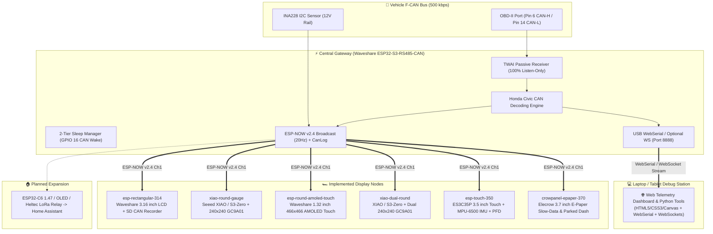

# Implementation Plan: espDash - Distributed Automotive Telemetry System

This implementation plan tracks the architecture for **espDash**, a distributed, low-latency, car-safe automotive telemetry network and web dashboard for the **2014 Honda Civic**. A central ESP32-S3 CAN Gateway captures vehicle bus data, measures the 12 V rail via an INA228 I2C sensor, broadcasts **ESP-NOW v2.4 (~1-3ms latency)** to multiple display nodes on fixed channel `1`, and streams JSON/raw CAN frames to a **Web Telemetry Dashboard** (WebSerial / optional WebSocket).

---

## 🏛️ System Architecture Diagram



---

## 📶 Multi-Network Wi-Fi & Credentials Specification

Every node incorporates **WiFiMulti** to automatically connect to whatever network is present:

| Network SSID | Password | Network Role / Location |
| :--- | :--- | :--- |
| **`Complex_parking`** | `12345678` | Garage / Parking Lot Network |
| **`Bazanski_ph`** | `52288488` | Mobile Phone Hotspot |
| **`Bazanski_IS`** | `52288488` | Home Network |
| **`IOT-monday`** | `fsdL2Dp*KBU0y#9F&c!Zbq853axj` | Office / Fallback Network |

* **Zero Disassembly Firmware Flashing:** Flash any gauge mounted in the vehicle dashboard wirelessly over Wi-Fi (`Complex_parking`, `Bazanski_ph`, `Bazanski_IS`, or `IOT-monday`) without removing trims or unplugging USB cables!

---

## 📁 Workspace Consolidation (`/Users/kickoff_laptop/Developer/espDash`)

The project is consolidated into a dedicated standalone workspace at `/Users/kickoff_laptop/Developer/espDash`:

```text
/Users/kickoff_laptop/Developer/espDash/
├── README.md
├── AGENTS.md
├── CLAUDE.md
├── docs/
│   ├── ARCHITECTURE.md
│   ├── CAN_PROTOCOL_MAP.md
│   ├── OTA_UPDATE_GUIDE.md
│   └── IMPLEMENTATION_PLAN.md
├── firmware/
│   ├── esp32-gateway/           # Central ESP32-S3 CAN Gateway Firmware
│   └── display-nodes/           # Universal gauge display node firmware
└── web-dashboard/               # HTML5/JS Web Telemetry Dashboard
```

---

## 🔄 Development & Rollout Phases

- [x] **Phase 0 (Workspace & Documentation Setup):** Consolidate `/Users/kickoff_laptop/Developer/espDash` workspace, Wi-Fi config, and architecture/CAN documentation.
- [x] **Phase 1 (Gateway ESP-NOW, INA228, Power Saving & Unit Tests):** Implemented passive 500 kbps TWAI decoder (`can_decode.cpp` + native regression suite), INA228 12 V battery monitor, 2-tier CAN-wake sleep, ESP-NOW v2.4 + `EspDashSignals.h` catalog, and raw CAN log streaming.
- [x] **Phase 2 (Modern Web Telemetry Dashboard & CLI Tools):** Built HTML5/JS Web Dashboard (`web-dashboard/`) with WebSerial & WebSocket support plus Python log collector/decoder tools (`tools/`).
- [x] **Phase 3 (Display Nodes Fleet):** Implemented `esp-rectangular-314` (with SD CAN recorder), `xiao-round-gauge`, `xiao-dual-round`, `esp-round-amoled-touch`, `esp-touch-350` (with 200 Hz MPU-6500 IMU + Airbus PFD page), and `crowpanel-epaper-370` (Elecrow 3.7" E-Paper slow-data & zero-power parked dash).
- [ ] **Phase 4 (Remaining Planned Nodes):** Waveshare ESP32-C6 1.47", OLED Shift Light, and Heltec Meshtastic Home Assistant LoRa Relay.
- [ ] **Phase 5 (Unmapped CAN Signals & Gateway IMU):** Capture ABS/TC/CEL activations (`docs/CAPTURE_ABS_TC.md`), script remaining `0x305` passenger/rear seatbelt bits, and evaluate optional gateway-level IMU (`ESPDASH_MSG_IMU`).
